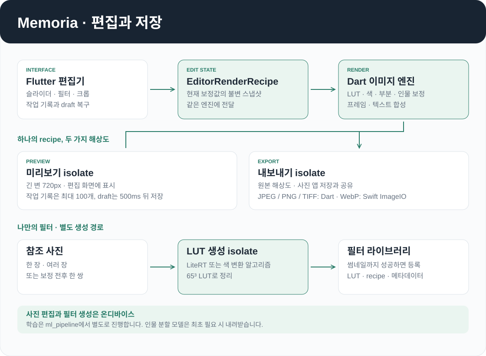

<div align="center">

# Memoria

[](https://github.com/cres17/memoria/actions/workflows/ios-build.yml)
[](LICENSE)


</div>

사진을 고르고 보정하고, 마음에 드는 사진의 색을 나만의 필터로 만들어 다시 쓰는 모바일 사진 편집 앱입니다. 모든 편집과 필터 생성은 서버 없이 기기 안에서 처리합니다. iOS를 기준으로 개발 중이며 Android 프로젝트도 함께 들어 있습니다.

- **편집**: Fuji 18종 · Leica 5종 LUT 필터, 노출 · 커브 · HSL 등 기본 보정, 크롭 · 원근, 부분 보정, 인물 영역 보정, 텍스트 · 프레임, undo/redo
- **나만의 필터**: 참조 사진 1장, 여러 장, 또는 보정 전후 사진 한 쌍으로 65³ LUT 필터 생성
- **내보내기**: JPEG · PNG · TIFF · WebP(iOS), 원본 해상도, 사진 앱 저장과 공유

## 전체 아키텍처

<p align="center">
  
</p>

| 흐름 | 설명 |
|------|------|
| 편집 | 편집기가 현재 보정값을 불변 `EditorRenderRecipe`로 묶어 이미지 엔진에 넘기고, 미리보기(긴 변 720px)와 원본 해상도 내보내기를 각각 별도 isolate에서 렌더링 |
| 기록 · 복구 | 적용한 작업은 `EditorHistoryController`가 최대 100개까지 보관하고, 편집 중 상태는 500ms debounce 후 `EditorDraftStore`가 SharedPreferences에 저장 |
| 필터 제작 | 참조 사진을 LiteRT 모델에 넣어 17³ LUT를 예측하고 65³로 보간, 썸네일 렌더까지 성공하면 LUT와 recipe를 `filters/<id>/`에 저장 |
| 인물 보정 | MediaPipe Selfie Segmenter로 사람 영역 마스크를 만들어 부드럽게 · 밝기 · 색조 보정에 사용 |
| 내보내기 | JPEG · PNG · TIFF는 Dart 인코더, WebP는 MethodChannel로 Swift의 ImageIO에 넘겨 인코딩 |
| 모델 준비 | `ml_pipeline`에서 PyTorch로 학습 → ONNX → TFLite(fp16)로 변환해 앱에 번들 |

```text
lib/
├── features/        home · editor · create_filter · filters · settings 화면과 서비스
├── engine/          LUT · 색 · crop · local · blur · portrait · export 엔진 (GPU 미리보기 위젯 gpu_image_view.dart 제외)
├── ai/              모델 설치 상태 관리와 TFLite 입출력 래퍼
├── domain/          EditOperation, FilterRecipe 모델과 저장소 계약
├── data/            JSON 파일 · SharedPreferences 저장 구현
├── core/            라우터 · 테마 · 언어 · 오류 로그
└── monetization/    광고 flag와 배너 · 전면 광고
ios/Runner/          LutEnginePlugin.swift (MethodChannel)
ml_pipeline/         데이터 생성 · 학습 · 평가 · ONNX/TFLite 변환 스크립트
```

## 각 기술 설명

### Flutter · go_router

화면은 HOME · GALLERY(필터 보관함) · EDIT · CREATE · 설정으로 나뉩니다. `core/router/app_router.dart`의 GoRouter가 HOME과 GALLERY는 하단 내비게이션을 공유하는 shell로, EDIT과 CREATE는 독립 화면으로 띄우며 iOS에서는 `CupertinoPage` 전환을 씁니다. 무거운 초기화(모델 설치 · 광고 SDK)는 첫 화면이 뜬 뒤로 미뤄 앱 시작을 막지 않습니다.

### 이미지 엔진 (Dart · isolate)

`lib/engine/`의 순수 Dart 함수들이 픽셀 연산을 담당합니다. LUT 적용(`lut_engine.dart`), 화이트밸런스 · HSL · 커브, 블러 · 브러시 · dodge/burn, 원근 변환, 인물 마스크 기반 보정, 프레임 · 텍스트 합성이 여기에 있습니다. 픽셀 연산 함수는 위젯에 의존하지 않기 때문에 미리보기 isolate와 내보내기 isolate가 같은 코드를 쓰고, 작은 fixture로 단위 테스트할 수 있습니다. 예외로 같은 폴더의 `gpu_image_view.dart`는 GPU 미리보기 위젯이고, `style_analyzer.dart`는 팔레트 추출에 Flutter의 `Color`를 씁니다. 미리보기는 같은 상태의 결과를 캐시해 반복 렌더링을 줄입니다.

### LiteRT (flutter_litert) — 나만의 필터

`CreateFilterPage`에서 고른 방식에 따라 LUT를 만듭니다. 생성 작업은 `IsolateCreateFilterGenerator`가 별도 isolate에서 45초 제한으로 실행하며, 취소나 실패 시 만들던 폴더를 지웁니다.

| 방식 | 구현 |
|------|------|
| 참조 사진 1장 | 번들 모델 `direct_mvp_color_transfer_fp16.tflite`가 256×256 입력에서 17³ LUT를 예측하고 `LutPredictor`가 65³로 보간. 모델 파일은 크기와 SHA-256을 확인한 뒤 사용 |
| 참조 사진 2~5장 | 사진별 색 분포를 통계적으로 합치는 알고리즘 방식 (다중 입력 모델은 없음) |
| Before / After 한 쌍 | `personal_filter_core.dart`가 대응 픽셀로 전역 affine 색 변환을 맞추고, 남은 오차를 작은 3D residual grid로 학습한 뒤 65³ LUT로 변환 |

추론이 실패하면 알고리즘 경로로 대체하고 그 이유를 `FilterRecipe`에 남깁니다. recipe에는 생성 방식 · 모델 버전 · 참조 수 · 안전성 지표가 함께 기록됩니다.

### MediaPipe Selfie Segmenter

인물 영역 보정에 쓰는 분할 모델입니다. 앱에 번들하지 않고, `ai_manager.dart`가 처음 필요할 때 Google Storage의 `selfie_segmenter.tflite`를 내려받아 저장합니다. 결과는 얼굴 피부가 아니라 사람 전체 영역 마스크입니다.

### Swift · Core Image · ImageIO

`ios/Runner/LutEnginePlugin.swift`가 `com.memoria/lut_engine` MethodChannel을 엽니다. Core Image의 `CIColorCube`로 LUT를 적용하는 네이티브 경로와, Dart에 인코더가 없는 WebP를 ImageIO(`CGImageDestination`)로 저장하는 경로를 제공합니다. Dart 쪽에서는 PNG 중간 파일을 넘깁니다.

### SharedPreferences · JSON 파일

편집 기록(`EditOperation` snapshot)과 화면 상태는 사진 경로별 키로 SharedPreferences에 draft로 저장해, 앱을 닫았다 열어도 이어서 편집할 수 있습니다. 사용자 필터는 앱 문서 디렉터리의 `filters/<id>/`에 LUT · 썸네일 · recipe · metadata 파일로 보관하고, `FilterCommitTransaction`이 썸네일 생성까지 끝난 필터만 목록 index에 추가합니다.

### PyTorch · ONNX · TensorFlow Lite (ml_pipeline)

번호 순 스크립트로 데이터 준비 · 학습 · 평가 · 변환을 진행합니다. LUT 수집과 학습 데이터 생성(`1_`, `2_`, `4_`, `5_`)부터 조건부 LUT 모델 학습(`20_train_conditional_lut_mvp.py`)과 평가 · 홀드아웃 비교를 거쳐, `34_`에서 `torch.onnx.export`로 ONNX를 만들고 `35_`에서 onnx-tf로 SavedModel을 거쳐 `TFLiteConverter`로 fp16 TFLite를 만듭니다. 인코더는 timm의 `mobilenetv3_small_100`입니다. `36_`은 변환된 모델의 추론 속도를 측정합니다.

### google_mobile_ads

`lib/monetization/`의 배너 · 전면 광고 위젯입니다. `feature_flags_service.dart`의 flag로 필터 제작 후 · 적용/내보내기 후 전면 광고 노출 여부를 따로 제어합니다.

### 테스트 · GitHub Actions

`test/`에는 엔진 · recipe · history · draft의 단위 테스트와 위젯 테스트가, `integration_test/`에는 실제 `EditorPage`를 띄우는 시나리오가 있습니다. `ios-build.yml`은 macOS runner에서 잠긴 의존성 설치 → 필수 asset 확인 → `flutter analyze` → `flutter test --coverage` → 서명 없는 iOS 빌드를 실행합니다.
