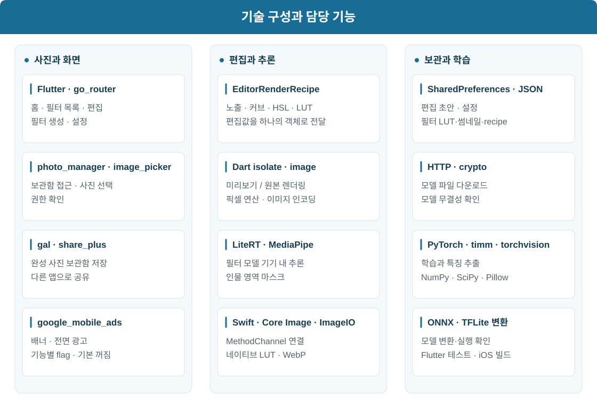

<p align="center">
  
</p>

<h1 align="center">Memoria</h1>

<p align="center">
  <a href="https://github.com/cres17/memoria/actions/workflows/ios-build.yml"></a>
  <a href="LICENSE"></a>
</p>

<p align="center">
  
  
  
  
  <br>
  
  
  
  
</p>

사진을 편집하고, 마음에 드는 사진의 색감을 필터로 만들어 보관하는 앱입니다. 편집과 필터 생성은 기기 안에서 처리합니다. iOS를 기준으로 개발하고 있으며 Android 프로젝트도 포함되어 있습니다.

[편집](#편집) · [구조](#구조) · [필터 생성](#필터-생성) · [모델 학습](#모델-학습) · [실행](#실행)

## 편집

<p></p>

Fuji 18종과 Leica 5종의 LUT 필터를 제공하며, 노출·커브·HSL을 조절할 수 있습니다. 크롭과 원근 보정, 부분 보정, 인물 보정, 텍스트와 프레임도 같은 편집기에 들어 있습니다.

슬라이더를 움직일 때마다 원본 해상도로 계산하면 조작이 무거워집니다. 화면에는 긴 변 720px의 미리보기를 사용하고, 저장할 때 원본 해상도로 다시 렌더링합니다. 미리보기와 저장에 같은 보정값과 엔진을 사용해 결과를 맞춥니다.

적용한 작업은 최대 100개까지 되돌릴 수 있습니다. 편집 중인 상태는 500ms debounce 후 저장하므로 앱을 닫았다 열어도 이어서 편집할 수 있습니다.

## 구조


화면은 현재 보정값을 불변 객체인 `EditorRenderRecipe`로 묶습니다. 렌더러는 이 recipe와 이미지 리소스를 받아 픽셀 연산을 수행합니다. 미리보기와 내보내기를 별도 isolate에서 실행해 무거운 작업이 화면 조작을 막지 않도록 했습니다.

| 위치 | 내용 |
|---|---|
| `lib/features/` | 홈, 편집기, 필터 생성, 필터 목록, 설정 |
| `lib/engine/` | LUT, 색 보정, 크롭, 블러, 인물 보정, 인코딩 |
| `lib/ai/` | 모델 설치와 LiteRT 입출력 |
| `lib/domain/` | 편집 작업과 필터 recipe, 저장소 계약 |
| `lib/data/` | JSON 파일과 SharedPreferences 저장 구현 |
| `ios/Runner/LutEnginePlugin.swift` | 네이티브 LUT 처리와 이미지 인코딩 연결 |
| `ml_pipeline/` | 학습 데이터 생성, 학습, 평가, 변환 |

### 렌더링 순서

`EditorRenderer`는 다음 순서로 보정을 적용합니다. 사용하지 않는 효과는 건너뜁니다.

1. 크롭·회전·원근 변환
2. 기본 색 보정과 LUT
3. 노이즈 감소·HDR·글로우·그레인·샤픈·클래리티·비네트
4. 아트 효과와 부분 보정, 닷지·번
5. 틸트시프트와 렌즈 블러
6. 인물 영역 보정
7. 블렌드·프레임·텍스트 합성

인물 보정은 MediaPipe Selfie Segmenter의 마스크를 사용합니다. 얼굴 피부만 분리하는 모델이 아니라 사람 전체를 분리하는 모델입니다. 이 모델은 처음 필요할 때 내려받아 저장합니다.

### 내보내기와 저장

JPEG·PNG·TIFF는 Dart에서 인코딩하고, iOS의 WebP는 MethodChannel을 통해 Swift ImageIO로 전달합니다. 완성한 이미지는 사진 앱에 저장하거나 공유할 수 있습니다.

편집 draft는 사진 경로별 키로 SharedPreferences에 보관합니다. 사용자 필터는 앱 문서 디렉터리의 `filters/<id>/` 아래에 LUT, 썸네일, recipe와 메타데이터를 함께 둡니다.

## 필터 생성

<p></p>


### 참조 사진 한 장

번들 모델 `direct_mvp_color_transfer_fp16.tflite`에 256×256 이미지를 입력합니다. 모델이 예측한 17³ LUT를 `LutPredictor`가 65³으로 보간합니다. 모델 설치 시 크기와 SHA-256을 확인하고, 설치나 추론이 실패하면 알고리즘 방식으로 대체합니다. 대체 이유는 recipe에 남깁니다.

### 참조 사진 여러 장

2~5장의 색 분포를 통계적으로 결합합니다. 여러 사진을 한 번에 입력받는 신경망 모델을 사용하는 경로는 아닙니다.

### 보정 전후 한 쌍

대응하는 픽셀을 이용해 전역 affine 색 변환을 맞춘 뒤, 남는 오차를 작은 3D residual grid로 보완합니다. 최종 결과는 다른 필터와 같은 65³ LUT로 저장합니다. 구현은 `lib/engine/personal_filter_core.dart`에 있습니다.

### 생성이 중단됐을 때

생성 작업에는 45초 제한을 둡니다. 사용자가 취소하거나 작업이 실패하면 새로 만든 폴더를 정리합니다. LUT 파일이 생겼다는 이유만으로 목록에 등록하지 않고, 썸네일 렌더링까지 성공한 뒤 `CreateFilterCommitTransaction`이 저장을 마칩니다. 미완성 필터가 목록에 남는 일을 막기 위한 처리입니다.

## 모델 학습

<p></p>

학습 파이프라인은 앱 실행과 분리되어 있습니다. 수집한 LUT로 학습 데이터를 만들고, `mobilenetv3_small_100`을 인코더로 사용하는 조건부 LUT 모델을 PyTorch에서 학습합니다.

| 단계 | 스크립트 |
|---|---|
| 학습 | `20_train_conditional_lut_mvp.py` |
| 출력 검증용 ONNX 내보내기 | `34_` 스크립트 |
| LiteRT 변환과 fp16 양자화 | `35_` 스크립트 |
| 변환 모델 속도 측정 | `36_` 스크립트 |

ONNX는 출력 비교에 사용합니다. 앱에 들어가는 TFLite 모델은 `litert-torch`로 PyTorch에서 직접 변환하고, `ai-edge-quantizer`로 가중치를 float16으로 줄입니다. 변환 전후 결과를 비교한 뒤 앱 번들에 넣습니다.

데이터 준비부터 평가까지의 명령은 [학습 파이프라인 문서](ml_pipeline/README.md)에 정리되어 있습니다.

## 기술별 역할



### 화면과 사진 입출력

Flutter와 go_router가 화면 이동을 맡습니다. 홈과 필터 목록은 하단 내비게이션을 공유하고 편집·필터 생성·설정은 독립 화면으로 열립니다. iOS에서는 Cupertino 방식으로 전환합니다. 개발 패널은 디버그 빌드에서만 라우트에 등록됩니다.

| 기술 | 맡은 기능 |
|---|---|
| Flutter · go_router | 홈, 필터 목록, 편집, 필터 생성, 설정의 이동과 화면 구성 |
| photo_manager · image_picker | 사진 보관함 접근과 입력 사진 선택 |
| permission_handler | 사진 접근 권한 요청 |
| gal · share_plus | 완성한 사진을 보관함에 저장하거나 다른 앱으로 공유 |
| image | Dart 이미지 디코딩·픽셀 처리·JPEG/PNG/TIFF 인코딩 |
| SharedPreferences | 편집 초안과 로컬 설정 유지 |
| path_provider · JSON 파일 | 사용자 필터의 LUT·썸네일·recipe·metadata를 앱 문서 폴더에 보관 |

### 렌더링과 모델 실행

편집 화면은 보정값을 `EditorRenderRecipe`로 전달하고 엔진은 그 값에 따라 픽셀을 계산합니다. 미리보기와 저장을 별도 isolate로 실행해 화면 조작과 무거운 처리를 분리합니다. 이 과정에서 사진을 서버로 올려 편집하지 않습니다.

| 기술 | 맡은 기능 |
|---|---|
| Dart isolate | 미리보기와 원본 렌더링의 연산 분리 |
| LUT · 보정 recipe | 필터 색 변환과 노출·커브·HSL 등 편집값 표현 |
| flutter_litert · LiteRT/TFLite | 설치된 모델의 기기 내 추론 |
| MediaPipe Selfie Segmenter | 부분 보정에 사용할 인물 전체 영역 마스크 생성 |
| Swift · MethodChannel | Dart와 iOS 네이티브 이미지 처리 연결 |
| Core Image · CIColorCube | 네이티브 LUT 적용 경로 |
| ImageIO | iOS 네이티브 이미지 인코딩, WebP 출력 경로 |
| HTTP · crypto | 모델 다운로드와 무결성 확인에 사용하는 구성 요소 |

MediaPipe 모델은 필요할 때 내려받아 보관합니다. 필터 생성 방식마다 사용하는 입력과 모델이 다르므로, 참조 사진 한 장·여러 장·보정 전후 사진 쌍의 흐름은 위의 필터 생성 절에서 따로 설명했습니다.

### 학습·배포와 광고

PyTorch·torchvision·timm은 학습 모델과 이미지 특징 추출에, NumPy·SciPy는 수치 처리에 사용합니다. Pillow와 imageio는 학습 이미지를 읽고 변환합니다. ONNX와 ONNX Runtime으로 변환·실행을 확인하고 TFLite 변환은 별도 환경에서 수행합니다. 학습 코드는 [ml_pipeline](ml_pipeline), 앱의 추론 연결은 [lib/ai](lib/ai)에 있습니다.

google_mobile_ads의 광고는 [feature_flags_service.dart](lib/monetization/feature_flags_service.dart)에서 제어합니다. 배너, 필터 생성 뒤 전면 광고, 적용·내보내기 뒤 전면 광고가 각각 별도 설정입니다. 기본값은 꺼짐이고 웹에서는 배너를 항상 끕니다. 사진 편집·필터 생성 기능과 광고 노출 조건을 분리해 두었습니다.

화면 코드는 [lib/features](lib/features), 렌더러는 [lib/engine](lib/engine), 네이티브 연결은 [LutEnginePlugin.swift](ios/Runner/LutEnginePlugin.swift)에 있습니다. Flutter 테스트와 통합 테스트, iOS 빌드 워크플로우로 앱 변경을 확인합니다.

## 실행

CI에서 사용하는 Flutter `3.44.6` stable을 기준으로 합니다. 앱에 필요한 LUT, 썸네일과 색 변환 모델은 저장소에 포함되어 있습니다.

```bash
flutter pub get --enforce-lockfile
flutter run
```

## 테스트

```bash
flutter analyze --no-fatal-infos
flutter test --coverage
flutter test integration_test
```

단위 테스트에서는 이미지 엔진, recipe, 작업 기록과 draft를 확인합니다. 통합 테스트는 실제 편집 화면을 띄우므로 기기나 에뮬레이터가 필요합니다.

`ios-build.yml`은 잠긴 의존성을 설치하고 필수 모델·LUT·썸네일을 확인한 뒤 정적 검사, 커버리지 테스트, 서명 없는 iOS 빌드를 수행합니다.
