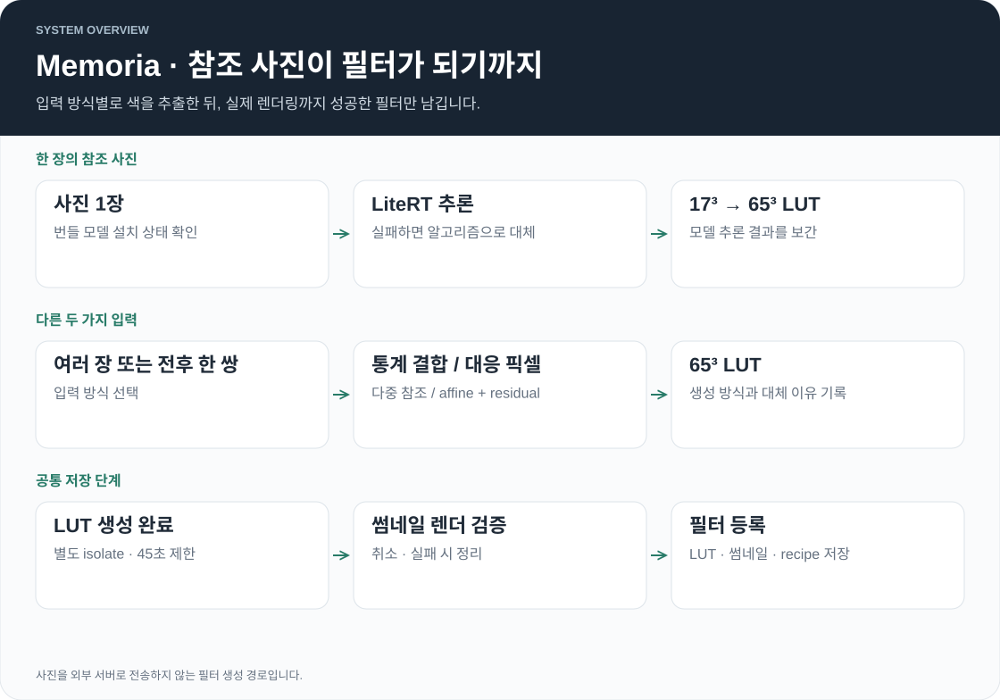
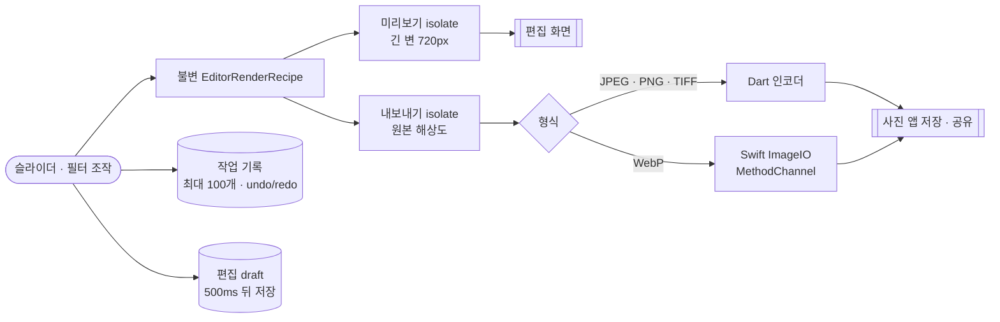
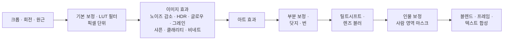
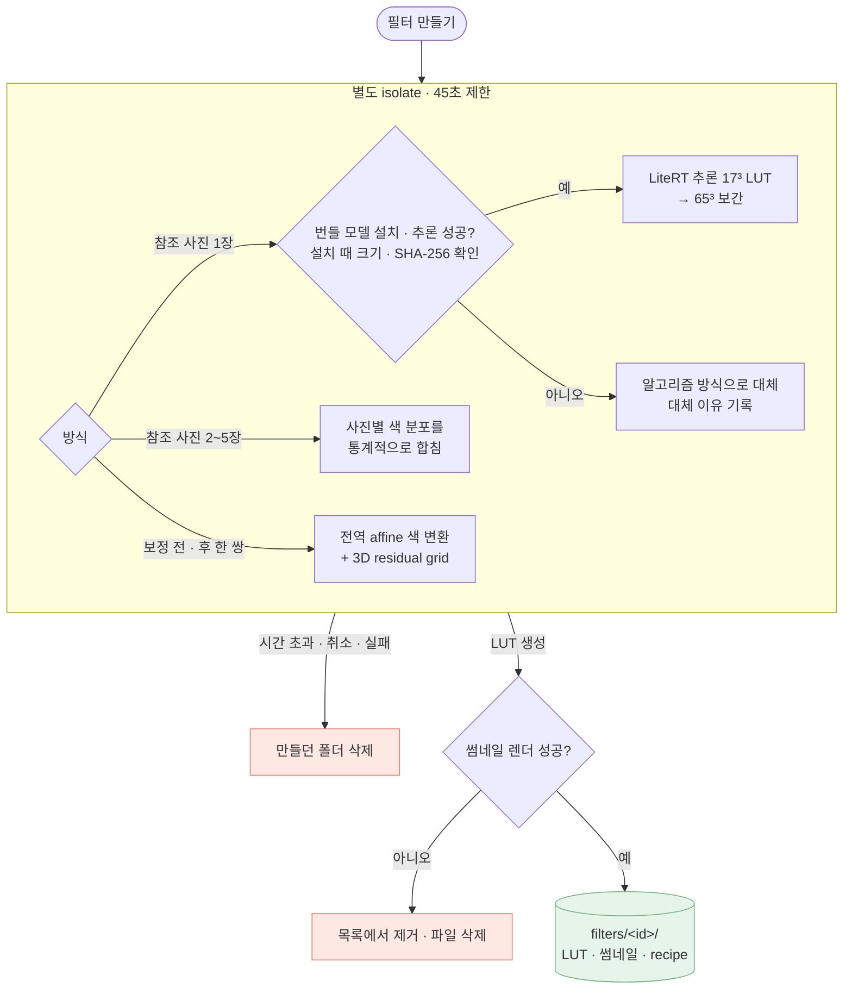
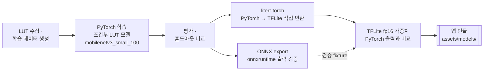

<div align="center">

# Memoria

[](https://github.com/cres17/memoria/actions/workflows/ios-build.yml)
[](LICENSE)

<p align="center">Flutter · Dart · LiteRT · Swift</p>

</div>

[구조](#architecture) · [주요 흐름](#workflow) · [설계 선택](#핵심-설계-결정) · [실행](#실행--검증)

사진을 고르고 보정하고, 마음에 드는 사진의 색을 나만의 필터로 만들어 다시 쓰는 모바일 사진 편집 앱입니다. 모든 편집과 필터 생성은 서버 없이 기기 안에서 처리합니다. iOS를 기준으로 개발 중이며 Android 프로젝트도 함께 들어 있습니다.

- **편집**: Fuji 18종 · Leica 5종 LUT 필터, 노출 · 커브 · HSL 등 기본 보정, 크롭 · 원근, 부분 보정, 인물 영역 보정, 텍스트 · 프레임, undo/redo
- **나만의 필터**: 참조 사진 1장, 여러 장, 또는 보정 전후 사진 한 쌍으로 65³ LUT 필터 생성
- **내보내기**: JPEG · PNG · TIFF · WebP(iOS), 원본 해상도, 사진 앱 저장과 공유

<a id="architecture"></a>

## 구조 한눈에 보기

<p align="center">
  
</p>

편집은 하나의 recipe와 공통 엔진을 사용합니다. 필터 생성은 별도 작업에서 완료한 뒤 라이브러리에 등록합니다.

| 흐름 | 설명 |
|------|------|
| 편집 | 편집기가 현재 보정값을 불변 `EditorRenderRecipe`로 묶어 이미지 엔진에 넘기고, 미리보기(긴 변 720px)와 원본 해상도 내보내기를 각각 별도 isolate에서 렌더링 |
| 기록 · 복구 | 적용한 작업은 `EditorHistoryController`가 최대 100개까지 보관하고, 편집 중 상태는 500ms debounce 후 `EditorDraftStore`가 SharedPreferences에 저장 |
| 필터 제작 | 참조 사진을 LiteRT 모델에 넣어 17³ LUT를 예측하고 65³로 보간, 썸네일 렌더까지 성공하면 LUT와 recipe를 `filters/<id>/`에 저장 |
| 인물 보정 | MediaPipe Selfie Segmenter로 사람 영역 마스크를 만들어 부드럽게 · 밝기 · 색조 보정에 사용 |
| 내보내기 | JPEG · PNG · TIFF는 Dart 인코더, WebP는 MethodChannel로 Swift의 ImageIO에 넘겨 인코딩 |
| 모델 준비 | `ml_pipeline`에서 PyTorch로 학습 → ONNX로 출력 검증, litert-torch로 TFLite(fp16) 변환 후 앱에 번들 |

```text
lib/
├── features/        home · editor · create_filter · filters · settings 화면과 서비스
├── engine/          LUT · 색 · crop · local · blur · portrait · export 엔진 (GPU 미리보기 위젯 gpu_image_view.dart 제외)
├── ai/              모델 설치 상태 관리와 TFLite 입출력 래퍼
├── domain/          EditOperation, FilterRecipe 모델과 저장소 계약
├── data/            JSON 파일 · SharedPreferences 저장 구현
├── core/            라우터 · 테마 · 언어 · 오류 로그
└── monetization/    광고 flag와 배너 · 전면 광고
ios/Runner/          LutEnginePlugin.swift (MethodChannel)
ml_pipeline/         데이터 생성 · 학습 · 평가 · ONNX/TFLite 변환 스크립트
```

<a id="workflow"></a>

## 주요 흐름



## 세부 동작

<details>
<summary><b>1. 편집과 내보내기</b></summary>

미리보기와 내보내기는 같은 recipe와 같은 엔진 코드를 쓰고, 해상도만 다릅니다.



</details>

<details>
<summary><b>2. 보정 적용 순서</b></summary>

`EditorRenderer`가 한 장의 사진에 아래 순서로 보정을 쌓습니다. 켜지 않은 단계는 건너뜁니다.



</details>

<details>
<summary><b>3. 나만의 필터 생성</b></summary>



</details>

<details>
<summary><b>4. 모델 준비 (ml_pipeline)</b></summary>



</details>


## 핵심 설계 결정

| 결정 | 방식 | 위치 |
|------|------|------|
| 픽셀 연산은 위젯과 분리한 순수 Dart | 미리보기 isolate와 내보내기 isolate가 같은 엔진 코드를 쓰므로 두 결과가 어긋나지 않고, 작은 fixture로 단위 테스트할 수 있습니다. 편집 상태는 불변 `EditorRenderRecipe`로 묶어 isolate에 넘깁니다. | `lib/engine/`, `lib/features/editor/editor_render_recipe.dart` |
| 필터 제작은 끝까지 성공한 것만 저장 | 생성은 별도 isolate에서 45초 제한으로 실행하고, 취소나 실패 시 만들던 폴더를 지웁니다. 썸네일 렌더까지 끝난 필터만 `CreateFilterCommitTransaction`이 목록 index에 추가합니다. | `lib/features/create_filter/create_filter_services.dart` |
| 모델 실패 시 알고리즘 경로로 대체 | 번들 TFLite 모델은 크기와 SHA-256을 확인한 뒤 설치하고, 추론이 실패하면 알고리즘 방식으로 대체합니다. 대체한 이유는 `FilterRecipe`에 남기며 생성 방식 · 모델 버전 · 참조 수 · 안전성 지표도 함께 기록합니다. | `lib/ai/ai_manager.dart`, `lib/ai/models/lut_predictor.dart` |
| 편집 중 상태를 잃지 않기 | 적용한 작업은 최대 100개까지 `EditorHistoryController`가 보관하고, 편집 중 상태는 500ms debounce 후 `EditorDraftStore`가 사진 경로별 키로 저장해 앱을 닫았다 열어도 이어서 편집할 수 있습니다. | `lib/features/editor/` |

## 나만의 필터 생성

`CreateFilterPage`에서 고른 방식에 따라 LUT를 만듭니다. 생성 작업은 `IsolateCreateFilterGenerator`가 실행합니다.

| 방식 | 구현 |
|------|------|
| 참조 사진 1장 | 번들 모델 `direct_mvp_color_transfer_fp16.tflite`(LiteRT, `flutter_litert`)가 256×256 입력에서 17³ LUT를 예측하고 `LutPredictor`가 65³로 보간 |
| 참조 사진 2~5장 | 사진별 색 분포를 통계적으로 합치는 알고리즘 방식 (다중 입력 모델은 없음) |
| Before / After 한 쌍 | `personal_filter_core.dart`가 대응 픽셀로 전역 affine 색 변환을 맞추고, 남은 오차를 작은 3D residual grid로 학습한 뒤 65³ LUT로 변환 |

## 모델 학습 (ml_pipeline)

번호 순 스크립트로 데이터 준비 · 학습 · 평가 · 변환을 진행합니다. LUT 수집과 학습 데이터 생성(`1_`, `2_`, `4_`, `5_`)부터 조건부 LUT 모델 학습(`20_train_conditional_lut_mvp.py`)과 평가 · 홀드아웃 비교를 거쳐, `34_`에서 `torch.onnx.export`로 ONNX를 만들어 출력을 검증하고, `35_`에서 litert-torch로 PyTorch 모델을 TFLite로 직접 변환한 뒤 ai-edge-quantizer로 가중치를 float16으로 줄입니다. 인코더는 timm의 `mobilenetv3_small_100`입니다. `36_`은 변환된 모델의 추론 속도를 측정합니다. 환경 설정과 단계별 명령은 [ml_pipeline/README.md](ml_pipeline/README.md)에 있습니다.

## 실행 · 검증

CI와 같은 Flutter `3.44.6`(stable)을 기준으로 합니다. 앱이 쓰는 모델(`assets/models/`)과 LUT, 썸네일은 저장소에 포함되어 있습니다.

```bash
flutter pub get --enforce-lockfile
flutter run                      # 연결된 기기 또는 시뮬레이터
```

```bash
flutter analyze --no-fatal-infos
flutter test --coverage          # 엔진 · recipe · history · draft 단위 테스트와 위젯 테스트
flutter test integration_test    # 실제 EditorPage를 띄우는 시나리오 (기기 또는 에뮬레이터)
```

`ios-build.yml`은 macOS runner에서 잠긴 의존성 설치 → 필수 asset 확인(모델 · LUT · 썸네일 개수) → `flutter analyze` → `flutter test --coverage` → 서명 없는 iOS 빌드를 실행합니다.

## 기술 구성

| 기술 | 용도 | 위치 |
|------|------|------|
| Flutter · go_router | HOME · GALLERY는 하단 내비게이션을 공유하는 shell, EDIT · CREATE는 독립 화면. iOS는 `CupertinoPage` 전환. 모델 설치 · 광고 SDK 같은 무거운 초기화는 첫 화면 뒤로 미룸 | `core/router/app_router.dart` |
| MediaPipe Selfie Segmenter | 인물 영역(얼굴 피부가 아닌 사람 전체) 마스크. 앱에 번들하지 않고 처음 필요할 때 Google Storage에서 내려받아 저장 | `lib/ai/ai_manager.dart` |
| Swift · Core Image · ImageIO | `com.memoria/lut_engine` MethodChannel. `CIColorCube`로 LUT를 적용하는 네이티브 경로와, Dart 인코더가 없는 WebP를 ImageIO로 저장하는 경로 | `ios/Runner/LutEnginePlugin.swift` |
| SharedPreferences · JSON 파일 | 편집 draft는 SharedPreferences에, 사용자 필터는 앱 문서 디렉터리 `filters/<id>/`에 LUT · 썸네일 · recipe · metadata 파일로 보관 | `lib/data/` |
| google_mobile_ads | 배너 · 전면 광고. `feature_flags_service.dart`의 flag로 필터 제작 후 · 적용/내보내기 후 전면 광고 노출을 따로 제어 | `lib/monetization/` |
