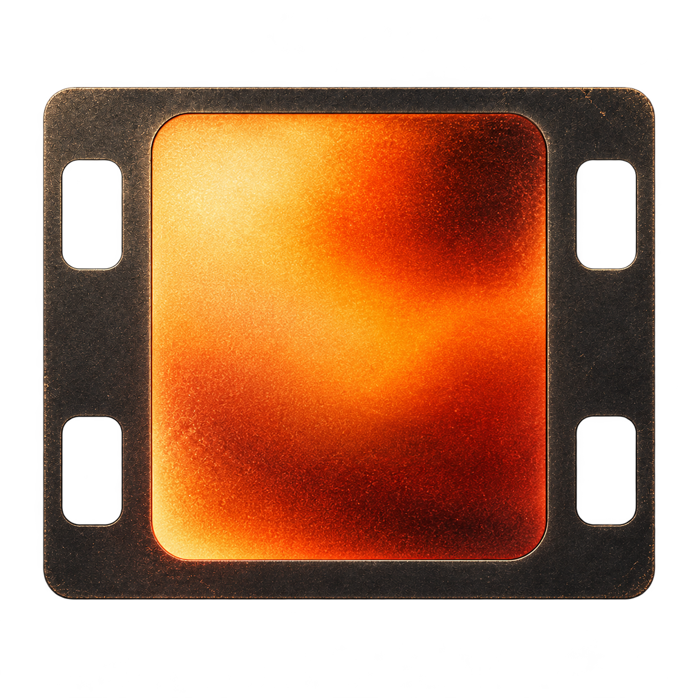

# Memoria 로고와 앱 아이콘

선택된 로고는 어두운 필름 프레임과 주황빛 아날로그 노출 질감을 결합한 디자인입니다.



- 원본: `assets/icons/memoria-mark.png`. 바깥 배경과 필름 구멍이 투명한 PNG이며, 선택한 이미지와 동일한 파일입니다.
- 인앱: `MemoriaMark` 공통 위젯을 시작 화면, 홈 로고, 앱 정보에 사용합니다. 화면에 앱 이름이 함께 있을 때 장식 이미지를 중복해서 읽지 않습니다.
- iOS: iPhone·iPad·App Store용 모든 크기를 내보내고 asset catalog의 filename을 연결합니다. 기존 PNG asset catalog용 앱 아이콘은 `#121316` 불투명 배경에 합성하며, 시작 화면 로고는 투명을 유지합니다.
- Android: 구버전의 일반·원형 아이콘과 adaptive icon을 내보냅니다. Adaptive foreground는 108dp 중 가운데 안전 영역에 들어가도록 여백을 둡니다. Android 12 시작 화면에도 같은 로고를 사용합니다.
- 웹·Windows: favicon, 일반·maskable PWA 아이콘, 여러 크기를 포함한 ICO 파일에 적용합니다.
- README: 같은 투명 원본을 상대 경로로 참조합니다.

## 다시 생성하기

Python 3와 Pillow가 설치된 환경에서 저장소 루트의 다음 명령을 실행합니다.

```sh
python3 tool/generate_brand_assets.py
```

생성기는 원본 그림을 다시 그리지 않고 크기·여백·플랫폼 배경과 마스크만 내보냅니다. 생성된 플랫폼 파일도 저장소에 함께 보관합니다.
